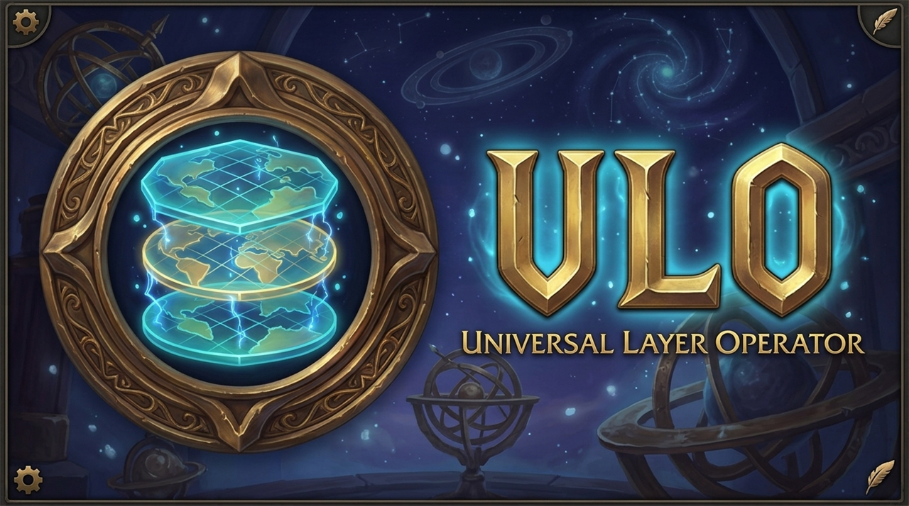

<p align="center">
  
</p>

# Universal Layer Operator (ULO)

**Universal Layer Operator (`ULO`)** is a multi-release World of Warcraft layer and shard operator built for **WoW Forever**, **Classic Era / SoD / Hardcore**, **TBC Anniversary**, **Mists Classic**, and **Retail**.

<p align="center">
  
</p>

## Key Features
- **Cross-Release Compatibility**: Single addon package with both universal (`ULO.toc`) and client-specific manifests (`ULO_Camelot.toc`, `ULO_Vanilla.toc`, `ULO_TBC.toc`, `ULO_Mists.toc`, `ULO_Mainline.toc`) and safe Retail secret-value (`issecretvalue`) / combat lockdown guards.
- **Layer & Shard Detection**: Inspects creature/NPC GUIDs and UnitTokens with a 10-sample consensus window to determine active layer IDs and confidence.
- **Layer Refresh Monitor**: Tracks 180s layer-refresh countdowns with out-of-combat safe `/reload` deferral and post-transfer cooldown tracking.
- **Automated Hopping & Interop**:
  - Keyword-driven automated whisper invites with blacklists, range/exclusion matching, 300s player throttling, LFG queue protection, and audio chime suppression.
  - Safe hop acceptance that leaves normal social party invites untouched.
  - Hop Any excludes the current known layer, contacts directed helpers before a public fallback, and accepts one invite per request. Scan nearby NPCs first if your layer is unknown.
  - Mode opens independent checkboxes for each supported request track; selections survive reloads.
  - Forever/TBC same-zone eligibility with normalized subzones and 90-second peer freshness. Legacy helpers use bounded post-join checks; forming a party is not transfer proof.
  - **AutoLayer** subscribes to static `layer` and three server-calendar Adler32 channels, sending one public request per hop with slots 1–5 protected. **Overlord 2.5.3** owns its native LayerJumper lifecycle and volunteer preferences. **NovaWorldBuffs** data is intelligence, not helper consent. See [implementation limits and follow-ups](docs/IMPLEMENTATION_TASKS.md).
- **In-Game UI**:
  - Circular bronze orbital Minimap Medallion showing the active layer (left-click toggles HUD, right-click opens Settings).
  - Draggable Status HUD (`Refresh` and `Hop` action buttons, countdown readout, SavedVariables position persistence).
  - Scrollable layer/request list covers layers 1–20, disables the current layer, and shows fresh eligible helper counts when advertised. Entries are candidate layer numbers, not proof those layers exist.
  - Actions starts closed after login/reload. Its `Linked / Free` button attaches it to the main window or lets it move and stay open independently; Free is the default.
  - Blizzard Settings / Interface Options integration and `/ulo` slash command control.

## Repository Structure
- `ULO/` — Installable World of Warcraft addon folder (`Interface\AddOns\ULO`).
- `Tests/` — Headless Lua test harness and 5-tier verification suite (247 tests).
- `.tools/` — Validation, PNG/TGA asset pipeline, multi-client local deployment, and release scripts.
- `.github/workflows/` — Automated GitHub Release & CurseForge publishing workflow.
- `docs/` — Technical specification and test documentation.

## Development & Verification
The CurseForge project is [Universal Layer Operator (ULO)](https://www.curseforge.com/wow/addons/universal-layer-operator-ulo).

Publishing a GitHub release runs the complete Lua and release-tool validation,
builds the immutable tagged addon ZIP with its TGA assets, and uploads it to
CurseForge. Configure repository secret `CURSEFORGE_API_TOKEN` and variable
`CURSEFORGE_PROJECT_ID` (`1819280`). Published release assets are not overwritten;
an upload receipt prevents repeat uploads of the same archive. Ordinary pushes
to `dev`/`main` and pull requests run verification without publishing.

Install dev dependencies once and run the full check suite (Lua 5.1 syntax, TOC/asset structure, and 247 Lua tests):
```powershell
npm install --ignore-scripts --no-audit --no-fund
npm test
```

## Local Multi-Client Deployment
Deploy `ULO` to all local World of Warcraft installations (`_anniversary_`, `_classic_`, `_classic_beta_`, `_classic_era_`, `_classic_era_ptr_`, `_forever_`, `_retail_`) with SHA-256 verification:
```powershell
npm run install:local
```

## Branches
- `main` — Stable tagged releases (`vX.Y.Z`).
- `dev` — Active development (`## Version: Dev`).
